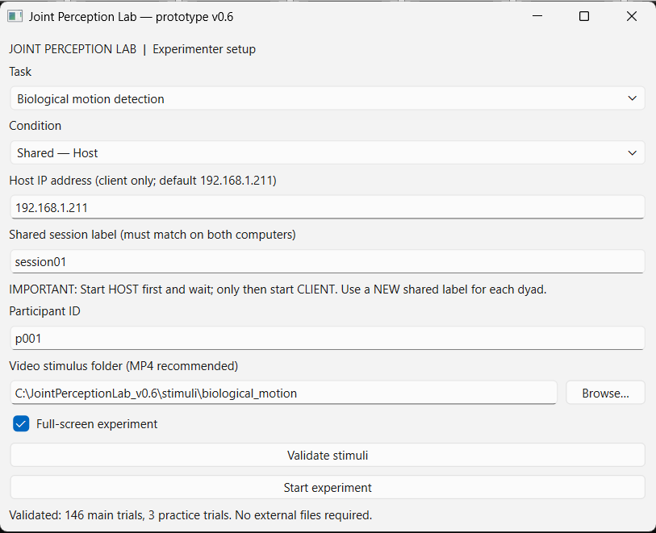

# Joint Perception Lab

**Version 0.6 — research prototype.** Desktop application for individual and dyadic biological-motion detection and numerical line-bisection tasks, using Python, PySide6, PsychoPy and TCP networking. **Not yet validated for research-grade display synchronisation or pixel-perfect replication of the historical line-bisection protocol.**

Authors: Itziar de Castro Urquiola , Alejandro Pérez

<p align="center">
  
</p>


## Start here

- [Experiment overview and exact trial order](docs/protocols/EXPERIMENTAL_DESIGN.md)
- [Biological-motion protocol](docs/protocols/BIOLOGICAL_MOTION.md)
- [Line-bisection protocol](docs/protocols/LINE_BISECTION.md)
- [Operator manual](docs/USER_MANUAL.md)
- [Data dictionary](docs/DATA_DICTIONARY.md)
- [Reproducibility and trial-sequence generation](docs/REPRODUCIBILITY.md)
- [Timing and synchronisation limitations](docs/validation/TIMING_AND_SYNCHRONISATION.md)
- [Manuscript-ready Methods draft](docs/manuscript/METHODS_DRAFT.md)
- [Software validation checklist](docs/validation/VALIDATION_CHECKLIST.md)
- [Changelog](CHANGELOG.md)

## Installation and running (Windows)

1. Install **Python 3.11 (64-bit)**. Extract the project.
2. For biological motion, copy the authorised stimulus MP4 files into `stimuli/biological_motion/`.
3. Run `setup_windows.bat` once; then run `run_windows.bat`.
4. In the experimenter GUI, choose task, condition and participant ID. Validate biological-motion stimuli, then start.
5. **Shared mode: start HOST first and leave it listening; only then start CLIENT.** Client Host IP defaults to `192.168.1.211`; verify the actual host IPv4 address. TCP port `48321` is used. Both computers need the same shared session label and task, and different participant IDs.
6. Output appears under `data/<session_id>/`. The `data/` directory is excluded from Git.

A Windows build helper (`build_windows.bat`) is included; **no tested Windows executable is distributed**. See `docs/USER_MANUAL.md`.

## Repository layout

```text
JointPerceptionLab/
├── joint_perception_lab/     # GUI, experiments, stimulus order, networking, timing, storage
├── tests/                    # automated Python tests
├── stimuli/                  # placeholders only; copyrighted videos excluded
├── docs/
│   ├── protocols/            # experimental specifications and sequence rules
│   ├── manuscript/           # Methods text for later adaptation
│   ├── validation/           # timing, sync and QA plans
│   └── development/          # software architecture and roadmap
├── launcher.py               # application entry point
├── setup_windows.bat         # install dependencies in .venv
├── run_windows.bat           # launch experimenter interface
├── build_windows.bat         # build helper, not a binary
├── requirements.txt
├── VERSION
└── CHANGELOG.md
```

## Reproducibility and research use

Biological motion: 80 unique factorial conditions (2 signals × 4 noise levels × 2 directions × 5 positions), repeated in two 80-trial blocks, with balanced cyclic signal transitions. Line bisection: 73 marker positions, each twice, in a single fixed shuffled order. Full details are in `docs/protocols/`.

Session seeds, trial orders and timing data are saved. Dyadic matching checks the ordered stimulus filenames or bisection order digest, **not stimulus file contents**. TCP readiness barriers are **not** simultaneous-photon-onset synchronisation.

## Ethics, data, assets, licensing

Do not commit participant identifiers, session outputs, IP-specific lab details beyond the documented default, or identifiable experimental records. The source-code license and third-party stimulus permissions must be decided by the project owner before public release; **no license is granted by this repository template**. Consult [LICENSE_DECISION.md](LICENSE_DECISION.md). Cite the eventual software release using [CITATION.cff](CITATION.cff) after verifying authorship and repository URL.
